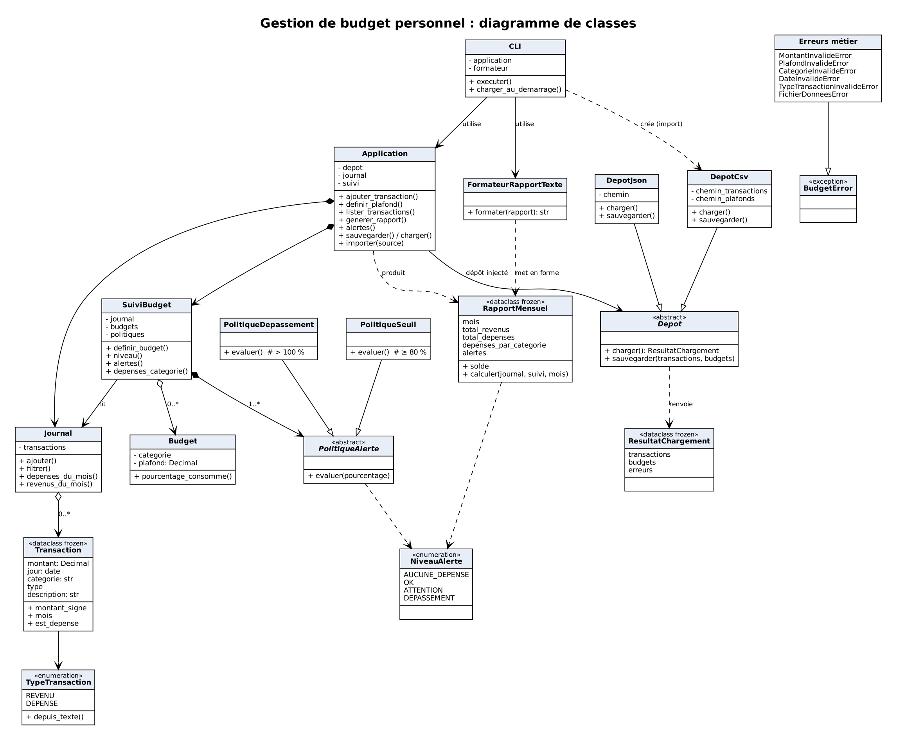

# Documentation de conception

Le cadrage initial (besoin, périmètre, stratégie de test) est dans
[Cadrage_et_conception.pdf](Cadrage_et_conception.pdf). Ce document décrit la conception
**telle qu'elle est réalisée**, et les écarts avec le cadrage.

## 1. Diagramme de classes

Sources : `diagrammes/diagramme_classes.dot` (Graphviz). Pour regénérer l'image :
`dot -Tpng -Gdpi=130 diagramme_classes.dot -o diagramme_classes.png`.

## 2. Classes et responsabilités

| Module | Classe | Responsabilité (une phrase) |
|---|---|---|
| `modeles.py` | `TypeTransaction` | Distinguer un revenu d'une dépense |
| | `Transaction` | Représenter une opération valide et immuable |
| | `Budget` | Porter le plafond mensuel d'une catégorie |
| `journal.py` | `Journal` | Conserver et filtrer les transactions |
| `alertes.py` | `NiveauAlerte` | Nommer les niveaux d'alerte |
| | `PolitiqueAlerte` | Définir le contrat d'une règle d'alerte |
| | `PolitiqueSeuil`, `PolitiqueDepassement` | Appliquer une règle (≥ 80 %, > 100 %) |
| `suivi.py` | `SuiviBudget` | Comparer les dépenses d'un mois aux plafonds |
| `rapport.py` | `RapportMensuel` | Porter les statistiques calculées d'un mois |
| | `FormateurRapportTexte` | Mettre un rapport en forme de texte |
| `depots.py` | `Depot` | Définir le contrat de lecture et d'écriture des données |
| | `DepotJson`, `DepotCsv` | Lire et écrire un format de fichier précis |
| | `ResultatChargement` | Transporter les données lues et les lignes rejetées |
| `application.py` | `Application` | Orchestrer les cas d'usage |
| `cli.py` | `CLI` | Dialoguer avec l'utilisateur |
| `erreurs.py` | `BudgetError` et 6 dérivées | Signaler une erreur métier précise |
| `constantes.py` | | Définir une seule fois seuils, formats et colonnes |

## 3. Relations entre classes

- **Agrégation** : `Journal` regroupe des `Transaction`, `SuiviBudget` regroupe des `Budget`.
  Ce sont des valeurs autonomes.
- **Composition** : `Application` détient son `Journal` et son `SuiviBudget` ;
  `SuiviBudget` détient ses `PolitiqueAlerte`.
- **Association** : `SuiviBudget` lit le `Journal` ; `CLI` utilise `Application`.
- **Héritage** : uniquement `PolitiqueAlerte` et `Depot`, les deux endroits où plusieurs
  implémentations interchangeables existent réellement. Tout le reste se compose.
- **Dépendance vers une abstraction** : `Application` ne connaît que `Depot`, jamais un format.

## 4. Principes appliqués

| Principe | Où |
|---|---|
| SRP | calcul (`RapportMensuel`), mise en forme (`FormateurRapportTexte`), stockage (`Depot*`), dialogue (`CLI`) |
| Open/Closed | nouvelle règle d'alerte = nouvelle classe ; menu de la CLI = table de dispatch |
| Liskov | `DepotJson` et `DepotCsv` passent les mêmes tests d'aller-retour |
| Inversion de dépendance | `Depot` injecté dans `Application` ; entrée et sortie injectées dans `CLI` |
| DRY | `valider_montant`, `valider_categorie` ; une seule conversion enregistrement → objet pour JSON et CSV |
| Constantes nommées | `constantes.py` : seuils, formats de date, colonnes CSV, devise |
| Encapsulation | `Journal` ne livre qu'une copie immuable ; `Transaction` gelée ; `Budget` en lecture seule |
| Erreurs explicites | hiérarchie `BudgetError` ; la CLI n'intercepte que `BudgetError` |
| Fonctions pures | calculs sans effet de bord ; effets (disque, écran) aux frontières |

## 5. Écarts par rapport au cadrage initial

| Cadrage | Réalisation | Raison |
|---|---|---|
| Montants non précisés | `Decimal` arrondi au centime | Pas d'erreur d'arrondi sur l'argent |
| 4 exceptions listées | 6 dérivées de `BudgetError` | `DateInvalideError` et `TypeTransactionInvalideError` utiles à la validation |
| `CLI` seule au-dessus du métier | `Application` ajoutée entre la CLI et le métier | La CLI ne contient aucune logique et reste testable |
| `Depot.charger()` sans détail | renvoie un `ResultatChargement` avec les lignes rejetées | Un import ne s'arrête jamais sur une ligne invalide |
| `DepotCsv` pour les transactions | accepte aussi un CSV de plafonds | Démontrer les alertes avec des données d'exemple |
| Pas de validation de mois | `lire_mois` | Refuser « 2026-13 » avant tout calcul |

## 6. Tests

187 tests (pytest), couverture 100 % du code de `src/budget/`, `ruff` en intégration continue
(complexité maximale 8 par fonction).

| Famille | Fichiers |
|---|---|
| Caractérisation de la V1 | `tests/legacy/` |
| Unitaires par module | `test_modeles`, `test_journal`, `test_alertes`, `test_suivi`, `test_rapport`, `test_depots` |
| Cas d'usage | `test_application` (faux dépôt en mémoire) |
| Interface | `test_cli` (sessions scriptées, y compris `python -m budget`) |

Les valeurs limites des alertes (79, 80, 100, 101 %) et les cas d'erreur (montant négatif, date
impossible, fichier absent, JSON corrompu, CSV incomplet) sont testés explicitement.

## 7. Limites connues et évolutions possibles

- Importer deux fois le même fichier ajoute deux fois les transactions : deux achats identiques
  le même jour sont légitimes, on ne peut pas dédoublonner automatiquement.
- `SuiviBudget.niveau()` lève une `KeyError` pour une catégorie sans plafond. `Application.alertes()`
  ne l'appelle que pour des catégories budgétées, donc l'utilisateur ne la rencontre pas.
- Un plafond est identique tous les mois ; une seule devise (EUR) ; pas de suppression ni de
  modification d'une transaction.
- Évolutions : suppression et édition, plafonds par mois, nouvelles politiques d'alerte,
  export du rapport.

## 8. Répartition du travail

| Membre | Contributions principales |
|---|---|
| Myriam | Version 1 legacy et tests de caractérisation ; refactorings qui produisent les trois « avant / après » : modèles, constantes, erreurs et journal (DRY), politiques d'alerte (Open/Closed), suivi et rapport (SRP) ; tests associés |
| Jinene | Cadrage, structure du dépôt, intégration continue, organisation Git ; dépôts JSON et CSV ; `Application` ; CLI ; installation du projet ; README et documentation ; tests associés |
| Ensemble | Conception initiale, relectures croisées par pull request, support de présentation, démonstration |

Le détail est visible dans l'historique Git et les pull requests (`docs/workflow_git.md`).
